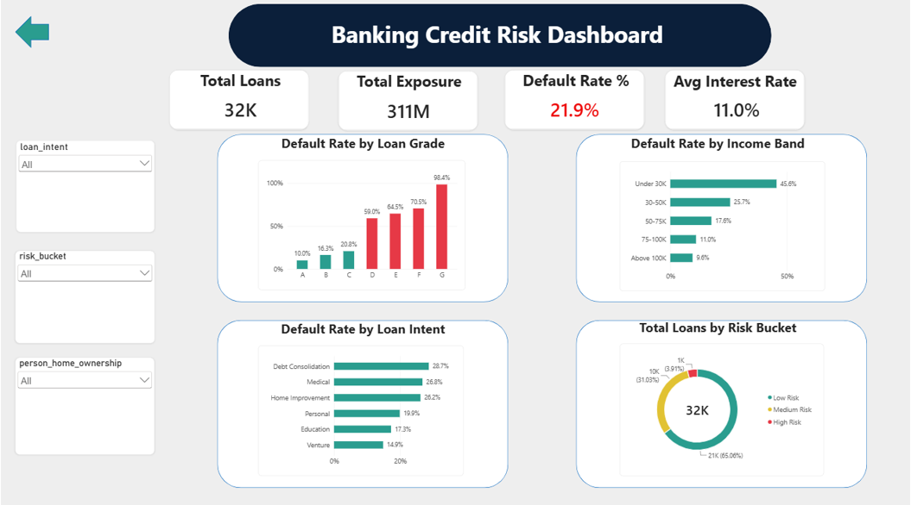
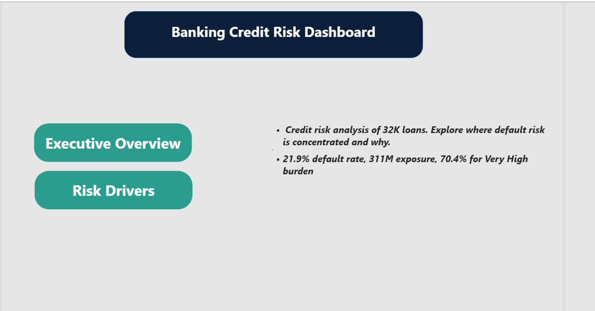
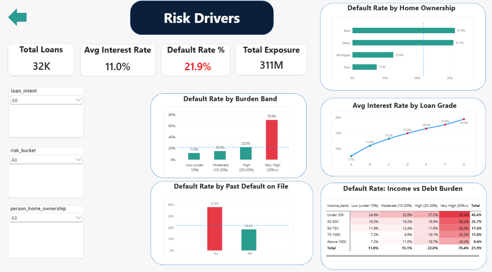

# Banking Credit Risk Analysis

**Who defaults, and why?** An end-to-end analysis of 32,409 loans using Python (cleaning and EDA) and a 3-page interactive Power BI dashboard.



---

## Overview

Banks lose money when borrowers stop repaying. This project finds where default risk is concentrated in a loan portfolio and which borrower and loan characteristics explain it, so lending, pricing and monitoring decisions can be targeted.

The dashboard is designed for a **bank Risk Manager**: page 1 summarises the portfolio, page 2 explains the causes of default.

## Key Findings

| # | Finding | Evidence |
|---|---|---|
| 1 | Overall default rate | **21.9%** of 32,409 loans (311M total exposure) |
| 2 | Debt burden is the strongest driver | Loans above 30% of income default at **70.4%**, vs 11.8% for loans under 10% |
| 3 | Credit grade has a cliff between C and D | Grades A-C: 10% to 21%. Grades D-G: **59% to 98%** |
| 4 | Income and burden combine | Under 30K income with a very high burden: **82.4%**. Even above 100K: 40.0% |
| 5 | Past default repeats | 37.9% with a default on file vs 18.4% without |
| 6 | Renting is riskier than owning | Rent 31.6% vs Own 7.5% |
| 7 | Pricing may not keep up with risk | From grade C to D the default rate nearly triples (20.8% to 59.0%), but the average interest rate rises only about 2 points (13.2% to 15.0%) |
| 8 | Age is not a meaningful factor | 20.2% to 23.1% across all age groups |

## Dashboard Preview

**Home**



**Executive Overview**: KPIs, default by grade, income band and loan purpose, portfolio mix by risk bucket.


**Risk Drivers**: debt burden, past default, home ownership, interest rate by grade, and a heat-map of income vs debt burden.



A PDF export of the dashboard is in [Banking_Risk_Dashboard.pdf](Banking_Risk_Dashboard.pdf).

## Data

- **Source:** [Credit Risk Dataset on Kaggle](https://www.kaggle.com/datasets/laotse/credit-risk-dataset) (`credit_risk_dataset.csv`)
- **Size:** 32,581 rows, 12 columns
- **Target:** `loan_status` (0 = repaid, 1 = defaulted)

The raw file is not included in this repository. Download it from Kaggle. The cleaned file is [banking_risk_clean.csv](banking_risk_clean.csv).

## Data Cleaning

| Step | Action | Rows before | Removed | Rows after |
|---|---|---|---|---|
| 1 | Load raw data | 32,581 | 0 | 32,581 |
| 2 | Remove exact duplicates | 32,581 | 165 | 32,416 |
| 3 | Remove impossible values (age > 100, employment > 60 years) | 32,416 | 7 | 32,409 |
| 4 | Fill missing employment length (895) and interest rate (3,116) with the **median** | 32,409 | 0 | 32,409 |
| 5 | Cap income at the 99th percentile (225,000) in a new column | 32,409 | 0 | 32,409 |
| 6 | Standardise labels and create banded columns | 32,409 | 0 | 32,409 |

Key decisions:
- **Median, not mean**, for missing values, because extreme values distort the mean.
- **Impossible values deleted, unusual values kept.** An age of 144 is an error. An income of 1.2 million is rare but believable (51 borrowers earned over 500K).
- **Income capped in a separate column** (`income_capped`), so the original income stays available.

## Feature Engineering

`age_group`, `income_band`, `loan_amount_band`, `burden_band`, `risk_bucket` (A-B Low, C-D Medium, E-G High), `loan_outcome`, and sort-order helper columns so Power BI shows bands in a logical order.

## Tools

- **Python:** pandas, matplotlib, seaborn (Google Colab / Jupyter)
- **Power BI Desktop:** data modelling, DAX measures, 3-page dashboard with navigation, synced slicers and conditional formatting

Example DAX:

```
Default Rate % = DIVIDE([Defaults], [Total Loans])
Defaults = CALCULATE(COUNTROWS(loan), loan[loan_status] = 1)
```

## Files

| File | What it is |
|---|---|
| `Banking_risk_analysis.ipynb` | Python notebook: cleaning and EDA |
| `banking_risk_clean.csv` | Cleaned dataset used in Power BI |
| `Banking_Risk_Dashboard.pbix` | Power BI dashboard (open in Power BI Desktop) |
| `Banking_Risk_Dashboard.pdf` | PDF export of the dashboard |
| `Banking_Credit_Risk_Report.docx` | Full written report |
| `home.png`, `executive_overview.png`, `risk_drivers.png` | Dashboard screenshots |

## How to Run

1. Clone or download this repository.
2. **Notebook:** download the raw dataset from Kaggle, place it next to the notebook, then run `Banking_risk_analysis.ipynb`. Requires Python 3 with `pandas`, `matplotlib` and `seaborn`.
3. **Dashboard:** open `Banking_Risk_Dashboard.pbix` in Power BI Desktop. If it asks for the data, go to **Transform data → Data source settings** and point it to `banking_risk_clean.csv`.

## Limitations

- The data has **no dates**, so trends over time could not be analysed.
- It has **no recovery or loss amounts**, so default rate is not the same as financial loss, and the pricing finding is a hypothesis.
- **Grade is assigned by the bank**, so it labels risk rather than causing it.
- Correlation is not causation, and all correlations are modest (the strongest is +0.38).
- Small groups (grade G, "Other" home ownership) give unstable percentages.

## Next Steps

- Try a dataset with dates so the dashboard can show trends.
- Build a simple model that predicts default.

## Report

The full written report is in [Banking_Credit_Risk_Report.docx](Banking_Credit_Risk_Report.docx).

## Author

**Mangesh Gaware**
GitHub: [@MangeshGaware0323](https://github.com/MangeshGaware0323)
